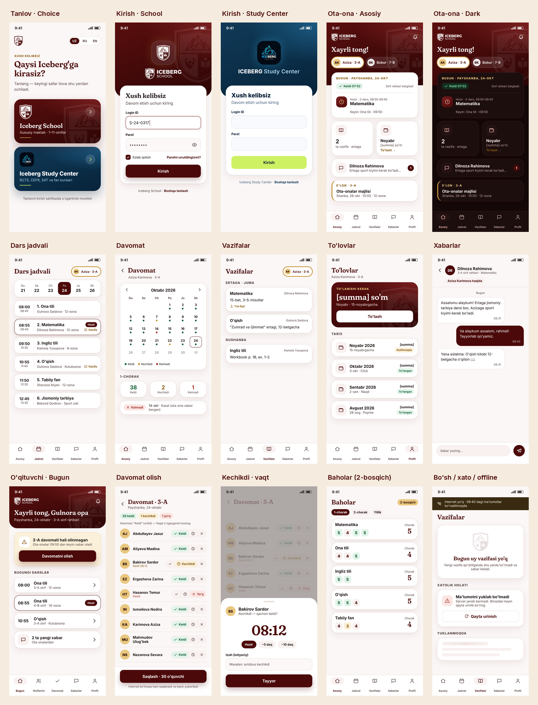

# Iceberg School App — Build Plan, Task Checklist and Agent Guide

Make the ERP and the Flutter app work for **Iceberg School** (private school, grades 1–11) next to the
**Iceberg Study Center** (the existing Learning Center), in **one app** on Google Play and the App
Store, with little to no errors.

This plan continues [`ICEBERG_SCHOOL_BRAND_PLAN.md`](ICEBERG_SCHOOL_BRAND_PLAN.md) (brand layer,
phases 1–5, done). That plan covers *how School looks*; this plan covers *what School does*.

---

## 0. How to use this plan (read first — every agent, every session)

1. Read `AGENTS.md`, then this section, then the **Status board** (section 1).
2. **Trust ticks.** A task marked `[x]` was finished, merged and verified as described in section 0.2.
   Do **not** re-check or redo it. Only reopen a `[x]` task if your own change breaks it or you can
   show it is broken (then follow 0.3).
3. Pick the **first open task in the earliest open phase** whose "Needs" are all `[x]`. Tasks inside
   a phase may run in parallel only when their "Needs" allow it.
4. **Claim** it before starting: change `[ ]` to `[~]` and add `— claimed YYYY-MM-DD, branch <name>`.
   Commit and push that one-line change first, so no other agent starts the same task. A claim older
   than 3 days with no linked PR may be taken over (say so in the Progress log).
5. Do the work on its own branch off `main` (`feat/school-<task-id>-<slug>`), one task per PR where
   possible. Small tasks in the same phase may share a PR; tick each one separately.
6. Before opening the PR, meet the **Definition of done** (0.1) and run the task's **Verify** steps.
7. In the **same PR**, mark the task done (0.2), update the Status board and add a Progress log line.
8. If a task needs an owner decision that is still open in section 2, stop and ask the owner; do not
   guess. Record the answer in section 2 with the date.

### 0.1 Definition of done (applies to every task)

A task is done only when **all** of these hold:

- [ ] The task's own **Done when** list is met and its **Verify** steps pass.
- [ ] Backend checks pass (run from `backend/`, same as CI):
      `python -m ruff check .` · `python -m ruff format --check .` · `python manage.py check` ·
      `python manage.py makemigrations --check --dry-run` · `python manage.py collectstatic --noinput --dry-run -v 0` ·
      `python manage.py test` (full suite, not only the new tests).
- [ ] App checks pass when `mobile/` changed (from `mobile/iceberg_app/`, Flutter **3.47.7**):
      `flutter analyze --no-fatal-infos` (0 errors, 0 warnings) · `flutter test` ·
      `flutter build web --release --base-href /app/`.
- [ ] **Tests added** for the new behaviour, including **access tests** for every new endpoint or
      page: the right role gets it, every other role and another branch's user gets 403/404, and a
      parent never sees another family's child (section 8.2).
- [ ] Branch scoping goes through `backend/main_app/branching.py` only (new `filter_*`/`user_can_*`
      helpers there). No inline branch filters in views, serializers or forms. New School modules go in
      `SCHOOL_MODULES` of `tests/test_scoping.py`, which checks this.
- [ ] Migrations are **additive** and generated with `makemigrations` (new models, new nullable or
      defaulted fields). No renames, no drops, no data loss. A data migration, if any, is reversible.
- [ ] Learning Center unchanged: the existing suite passes, and Study Center users see no new School
      screens, wording or fields.
- [ ] Every new user-facing string exists in **Uzbek, Russian and English** (web templates and
      `mobile/iceberg_app/lib/core/i18n/strings.dart`).
- [ ] Screens (app or web) match the owner-approved mockup (PD.8) and the rules in section 6; the PR
      shows screenshots at phone size in uz and ru, light and dark.
- [ ] Docs updated where behaviour changed (this plan; `docs/DEPLOYMENT.md` for env vars;
      `.env.example` for new settings).
- [ ] CI green on the PR (Django CI and Flutter CI). The "Workers Builds: college-erp" check is a
      known Cloudflare misconfiguration (task P0.3) and does not block.

### 0.2 How to mark a task done

In the PR that completes the task, change the line to:

```
- [x] **S1.2** Classes on groups — done 2026-11-02, PR #41; verified: full suite 214 OK, access tests ClassAccessTests
```

- Use the date the PR is merged (or opened, then correct it after merge if it changed).
- Name the PR and the test classes or commands that prove it.
- Update the phase line in the Status board (`3/6 done`) and, when the last task of a phase is ticked,
  set the phase to **Done** with the date.
- Add one line to the Progress log (section 11): date, task IDs, PR, anything the next agent must know.

### 0.3 If a done task turns out broken

Change `[x]` back to `[ ]`, append `— reopened YYYY-MM-DD: <what is broken, how to reproduce>`, and log
it. Fix it like any other task. Never silently "fix" another task's code without reopening it.

### 0.4 Legend

`[ ]` open · `[~]` claimed / in progress · `[x]` done (see 0.2) · `[-]` dropped (with reason) ·
**Owner** = needs the owner (not code) · **Needs** = tasks that must be `[x]` first.

---

## 1. Status board

| Phase | What | Status |
|---|---|---|
| P0 | Foundations: hosting, domain, open PRs merged, staging, monitoring | In progress — 1/8 |
| P1 | ERP school data model: years and quarters, classes, subjects, parents | Done — 8/8 |
| P2 | ERP school features: timetable, register, gradebook, parent messages, push | In progress — 7/8 |
| PD | Design: rules, mockups, owner approval (before P3/P4 code) | In progress — 6/9 (mockups 1–20b drawn) |
| P3 | Web screens for admins (D15: teachers use the app) | Done — 7/7 (2026-10-31; P3.4, P3.5 dropped) |
| P4 | App: choice screen, parent role, School screens | In progress — 5/12 (P4.11 dropped) |
| P5 | Store readiness (Android and iPhone builds, listings, policies) | Open — 0/9 |
| PL | Launch readiness: onboarding, support, training, consent | Open — 0/7 |
| P6 | Pilot and quality | Open — 1/6 |
| P7 | Release to Google Play and the App Store | Open — 0/5 |
| P8 | Online payments with Payme or Click (after the first release, D16) | Open — 0/3 |
| P9 | eMaktab connection (future feature, after Release 2, D18) | Future — 0/2 |

**Release 1 (first store version)** = P0, P1 (P1.7 without CSV import), P2.1–P2.3 + P2.6–P2.8, PD
(without PD.5), P3.1–P3.3 + P3.6, P4 (without P4.7, P4.11, P4.12), P5, PL, P6, P7. **Release 2 (store
update)** = gradebook (P2.4–P2.5, PD.5, P4.7), report cards, CSV import of parents, minimum app version
(P4.12), and online payments (P8).
The gradebook (Release 2) must ship before all parents start on 2 Sep 2027 (D10).

Scope rule (D16): this is a **simple tracking app** for admins, teachers, students and parents. Don't add
integrations or extras that aren't in this plan without asking the owner.

### 1.1 Target timeline (proposed 2026-10-26; dates confirmed by D10 on 2026-10-28)

| When | What | Phases |
|---|---|---|
| Oct–Nov 2026 | **Owner, now:** D-U-N-S number → Google Play and Apple organisation accounts; hosting (D9) after the data-law check (D12); approve mockups (PD.8). Cleanup PR (dead code, archived old plans) | P0, PD.8, P5.1 |
| Nov – mid Dec 2026 | School data model and parent role, demo data | P1, P0.6 |
| mid Dec 2026 – Jan 2027 | Timetable, register, absence alerts, teacher–parent messages, invoices for parents, push | P2 (Release 1 parts) |
| Jan – Feb 2027 | Admin web screens; app screens (choice, parent home, timetable, register, homework, payments view, messages) | P3, P4 |
| Feb – Mar 2027 | Store readiness and launch readiness. **Owner:** Payme/Click merchant contract (for P8) | P5, PL |
| Mar – Apr 2027 | Pilot in the 4th quarter (from ~30 Mar) with 1–2 classes' teachers and parents, fix blockers | P6 |
| late Apr – May 2027 | Store submission and release | P7 |
| Jun – Aug 2027 | Release 2 before the new year: gradebook first, then CSV import, minimum version | P2.4–2.5, P4.7 |
| 2 Sep 2027 | **All parents start**: login letters at the start-of-year parent meetings (D14) | PL |
| after that | Online payments (P8) | P8 |


---

## 2. Decisions

| # | Decision | Status |
|---|---|---|
| D1 | **One app** for both. First screen asks: Iceberg School or Iceberg Study Center. The account's branch decides after login (section 5.1). | Decided 2026-10-23 (owner) |
| D2 | Attendance: **daily register** by the homeroom teacher in Release 1 (with arrival time); marks per lesson later. | **Decided 2026-10-23 (owner)** |
| D3 | Grades: marks **2–5** per subject per date, **quarter** (chorak) and **year** grades; report card later. | **Decided 2026-10-23 (owner)** |
| D4 | Parent is a **new role** `user_type "4"`, linked to one or more children; one login sees all their children (School and Study Center). | **Decided 2026-10-23 (owner)** |
| D5 | A school **class** (7-B) is a `Group` with `kind="class"`, so attendance, homework, chat and invoices keep working. | Proposed (technical) |
| D6 | The academic year reuses the existing `Session` model (add `name`, `is_current`); quarters are a new `Term` model. | Proposed (technical) |
| D7 | Choice-screen label for the Learning Center: **"Iceberg Study Center"** (same in uz/ru/en; the logo carries the brand). | **Decided 2026-10-23 (owner)** |
| D8 | Store accounts: **organisation** for both Google Play and Apple (seller shown as the organisation; Play skips the 12-tester/14-day rule for new personal accounts). Needs a free **D-U-N-S number** (1–2 weeks) — apply first. | **Decided 2026-10-23 (owner)** |
| D9 | Hosting for the ERP (DigitalOcean is stopped): **one Docker VPS in an EU data centre (Frankfurt/Germany)** running the existing `Dockerfile`, with PostgreSQL on the same server and a daily off-site backup (P0.7). Provider: whichever the owner can pay from Uzbekistan (Hetzner is the cheapest; DigitalOcean Frankfurt if the old account is reused). Not Cloudflare Containers + Neon + R2: three vendors and a newer container product for a small app. Uzbekistan → Frankfurt is fast enough for forms and lists. Can move to an Uzbek host later with the same image if D12 ever requires it. | **Decided 2026-10-28** (owner delegated; research 2.1) |
| D10 | Target dates: keep the **store release in spring 2027** (P7) with a **pilot in the 4th quarter** (from ~30 Mar 2027) with the homeroom teachers and parents of 1–2 classes. **All parents start on 2 Sep 2027**, at the start-of-year parent meetings (ota-onalar majlisi), not in May when the year ends ~25 May. The **gradebook (Release 2) must ship before 2 Sep 2027**, because marks and attendance are what Uzbek parents already check in eMaktab. | **Decided 2026-10-28** (owner delegated; research 2.1) |
| D11 | Leaderboard, vocabulary and flashcards are **Study Center only**; School users never see them. | **Decided 2026-10-23 (owner)** |
| D12 | Data law: since **27 Mar 2026** the Law "On Personal Data" requires storage **in Uzbekistan only for biometric, genetic and telecom-subscriber data**. Other personal data may be stored abroad in a country with "adequate" protection (Cabinet of Ministers list) or under approved standard contractual clauses. The ERP stores **no biometric data**: keep it that way (no Face ID login data, no face photos for attendance). So EU hosting (D9) is allowed for staging and the pilot. **Before real families' data (P6.3)**, one short check with a local lawyer: is Germany on the adequacy list, and what must the privacy policy (P5.5) and parental consent (PL) say? | **Decided 2026-10-28** (owner delegated; research 2.1), lawyer check before P6.3 |
| D13 | Parent password resets: **SMS code through Eskiz** (already used for payment reminders in `main_app/payments.py`; about 85 soʻm per SMS, so 1,000 resets ≈ 85,000 soʻm), sent to the phone stored on the parent (P1.7). **Reset by the school office** (admin API from P1.7) stays as the fallback. Rate-limit codes per phone. | **Decided 2026-10-28** (owner delegated; research 2.1) |
| D14 | How parents receive logins: **both**. A **printed letter** (login ID, temporary password, QR to the store pages; PL.1) handed out at the parent meeting, which is where Uzbek schools give parents such information. Plus an **SMS with the login ID and the store link** (no password in SMS) for parents who missed the meeting or lost the letter; they then set a password with the D13 SMS code. | **Decided 2026-10-28** (owner delegated; research 2.1) |
| D15 | Where each role works: **admins on the Django web ERP; teachers, students and parents in the app** (phone, or browser at `/app/`). New School features are built once, in the API + app. The Django student/teacher pages are frozen (bug fixes only) and removed once the app covers them. Drops P3.4 and P3.5. | **Decided 2026-10-26 (owner)** |
| D16 | Scope: a **simple tracking app**. No government-system integration (eMaktab, Kundalik) in Release 1 or 2; eMaktab comes later as P9 (D18). Online payments with **Payme or Click come last** (P8, after the first release). Offline register (P4.11) dropped. | **Decided 2026-10-26 (owner)** |
| D17 | Admin web language: office staff need the **admin pages in Uzbek and Russian** (English stays). The admin web has no Django i18n today, so P3.0 adds it before the School admin pages. | **Decided 2026-10-27 (owner)** |
| D18 | **eMaktab: the school does keep the state eMaktab journal** (required for general education schools). Connecting this app to eMaktab is a **future feature (P9), not in Release 1 or 2**. Until then teachers fill in eMaktab as they do today, and this app's register and gradebook serve parents and the office. Design the register, marks and term grades so they can later be sent to eMaktab or exported (store per-lesson and per-date data, use the same 2–5 scale and quarters as eMaktab, keep student identifiers). Don't build any eMaktab code before P9. | **Decided 2026-10-28 (owner)** |

Record each answer here with the date before starting the task that depends on it.

### 2.1 How Uzbek schools work (research 2026-10-28)

The owner asked the agent to decide D9, D10, D12–D14 and PD.8 from how Uzbek schools operate. Findings
(web sources, checked 2026-10-28; official texts on lex.uz and the ministry site win if they differ):

- **Calendar.** Classes start **2 Sep 2026**; autumn break **4–9 Nov**, 2nd quarter from **10 Nov**. In
  2025–26 the winter break was 14 days from 28 Dec (27 Dec for grades 1–4) to 10 Jan, 3rd quarter from
  12 Jan; spring break about 19–29 Mar, 4th quarter from 30 Mar; the year ends late May. So 2026–27 is
  about: Q1 2 Sep–3 Nov, Q2 10 Nov–26 Dec, Q3 11 Jan–18 Mar, Q4 30 Mar–25 May. Exact dates come in
  ministry orders each year, so **quarters stay admin-editable data** (P1.1), never hard-coded.
- **Week and lessons.** Monday–Saturday school week, 45-minute lessons; some schools run two shifts.
  The timetable (P2.1) needs weekdays 1–6 and bell periods per branch (already planned). The grade 1–4
  break starting on a Saturday suggests younger grades may have Saturdays off, so a class's week must
  allow an empty Saturday.
- **Marks.** Scale **2–5** (5 excellent, 4 good, 3 satisfactory, 2 unsatisfactory; 1 is not used),
  quarter (chorak) and year grades. Matches D3 and the mockups.
- **eMaktab.** The state electronic journal and diary (formerly Kundalik). Attendance and marks in "all
  general education schools" are kept there; teachers mark the journal right after each lesson; the
  journal is kept 25 years; parents already see marks and homework there, and a fintech service for
  parents of **private schools in Tashkent** is being piloted from Sep 2026. Whether a private school
  must use it is not stated in what was found → **D18**. Teachers and parents also use **Telegram
  groups** informally; our app should replace those, not compete with eMaktab on paperwork.
- **Personal data.** The 2021 rule that all citizens' data must sit on servers in Uzbekistan was
  narrowed on **27 Mar 2026** to biometric, genetic and telecom-subscriber data; other data may go
  abroad to "adequate" countries or under standard contractual clauses. Sources disagree on whether
  the adequacy list (49 countries) is published yet → lawyer check in D12.
- **Private-school licence.** Issued by the education quality inspectorate through the state services
  portal; the 2024 changes eased teacher and class-size requirements. Nothing found about software.
- **SMS.** Eskiz charges about 85 soʻm per SMS to all operators (an undated listing; confirm on
  eskiz.uz).

Sources: [yep.uz — 2026/27 start dates](https://yep.uz/en/2026/08/uzbekistan-2026-2027-academic-year-start-dates/),
[yuz.uz — autumn break](https://yuz.uz/en/news/osennie-kanikuly-v-skolax-uzbekistana-nacnutsia-4-noiabria),
[anhor.uz — winter break 2025/26](https://anhor.uz/news/school-18/),
[talimxabarlari.uz — spring break 2026](https://talimxabarlari.uz/?p=68883),
[Wikipedia — Education in Uzbekistan](https://en.wikipedia.org/wiki/Education_in_Uzbekistan),
[daryo.uz — eMaktab stays](https://daryo.uz/ru/2026/02/04/shkoly-uzbekistana-ne-vozvrashchayutsya-k-bumazhnym-dnevnikam-i-klassnym-zhurnalam-ministerstvo/),
[idum.uz — eMaktab journal instruction](https://idum.uz/ru/archives/18194),
[dgov.uz — eMaktab](https://dgov.uz/en/solution-detail/30),
[gazeta.uz — eMaktab 2026/27 update](https://www.gazeta.uz/oz/2026/08/25/e-maktab/),
[kun.uz — teachers' Telegram groups](https://kun.uz/ru/news/2020/03/19/pochemu-fotografii-opozdavshix-uchenikov-urgutskoy-shkoly-razletelis-v-messendjyere),
[Dentons — data localization narrowed](https://www.dentons.com/en/insights/articles/2026/march/31/uzbekistan-dismantles-strict-data-localization-regime),
[Settle Advisory](https://settleadvisory.com/news-en/localization-of-personal-data-in-uzbekistan-transition-to-a-more-flexible-regulatory-model/),
[The Diplomat — adequacy list](https://thediplomat.com/2026/10/from-data-localization-to-digital-openness-uzbekistans-regulatory-shift/),
[lex.uz — private school licensing (2024)](https://www.lex.uz/docs/-7286573),
[Bitrix24 — Eskiz SMS rate](https://www.bitrix24.ru/apps/app/vebpult.eskiz_sms_shlyuz_uzbekistan/).

---

## 3. Facts about the code today (verified 2026-10-23 on `feat/school-brand-phase-5`)

- **Roles**: `CustomUser.user_type` `"1"` admin, `"2"` staff, `"3"` student (`max_length=1`).
  `main_app/middleware.py` `LoginCheckMiddleWare` routes by role and **logs out any unknown
  `user_type`** — a parent role must be added there first (P1.5).
- **API** (`/api/v1/`, DRF + SimpleJWT): 83 routes in `main_app/api/urls.py`; permissions in
  `main_app/api/permissions.py` (`IsAdmin`, `IsTeacher`, `IsStudent`, `IsAdminOrTeacher`).
- **App ↔ API**: all 47 API paths the app calls exist (checked by resolving them with Django). The app
  serves students and staff; admins see a "coming soon" screen; there is no parent role.
- **Course model**: `Student.course` (one course), `Group` (course, teacher, branch, `room`, free-text
  `schedule`, `monthly_fee`), `Enrollment` (student ↔ group), `Subject` (course + one staff).
- **Attendance**: `Attendance` = one group + one date; `AttendanceReport` = student + status
  (absent, present, late). No time of arrival, no per-lesson marks.
- **Results**: `StudentResult` = one per student per group (`test` ≤ 40, `exam` ≤ 60). No gradebook.
- **Academic year**: `Session(start_year, end_year)` exists (admin endpoints `admin/sessions/`), no terms.
- **Payments**: `Invoice` (student, group, `period` = first day of month) and `Payment` — fit a school.
- **Chat**: `ChatThread` is one per group (students and teacher). No teacher ↔ parent threads.
- **Push**: `CustomUser.fcm_token` is stored (`api/v1/me/fcm-token/`), but sending was removed with the
  legacy FCM API (PR #26). In-app notifications work; phone push does not.
- **Brand**: `Branch.brand` (`center`/`school`), `main_app/branding.py`, flag `SCHOOL_BRAND_ENABLED`;
  app: `lib/core/theme/brand.dart`, `brand_provider.dart`. Time zone `Asia/Tashkent`.
- **App code**: 59 Dart files (~22k lines), `lib/core/router/app_router.dart`,
  `lib/features/{auth,staff,student}`, `lib/shared`. Largest file:
  `lib/features/staff/screens/staff_feature_screens.dart` (~2,200 lines). One placeholder test.
- **Open PRs at the time of writing**: #26 security fixes → #27 School brand (base #26) → #28 build
  cleanup (Docker builds the web app, CI split by area, download-page fix).

---

## 4. Architecture

### 4.1 Data model (P1, P2) — all additive

```
Session (academic year)   + name "2026–2027", is_current (one per branch at most)
Term (quarter)            session, number 1–4, name, start_date, end_date
Group                     + kind ("course" default | "class"), grade_level 1–11, letter "B",
                            session (FK, null), homeroom = existing `teacher`
ClassSubject              group(kind=class), subject, teacher (Staff), weekly_hours
Subject                   unchanged; school subjects belong to one "Iceberg School" Course per
                            school branch (created in P1.3), so Subject.course stays required
Parent (profile)          admin OneToOne CustomUser(user_type "4"), phone, relation
ParentChild               parent, student, relation ("mother", "father", "guardian"), is_primary
BellPeriod                branch, number, start_time, end_time
Lesson (timetable)        group(kind=class), weekday 1–6, period, class_subject, room, valid_from/to
AttendanceReport          + arrival_time (null), + note
Mark (gradebook)          student, class_subject, date, value 2–5, kind ("lesson","test","exam"), comment, given_by
TermGrade                 student, class_subject, term, value 2–5 (null = not graded), final for year = term NULL
ChatThread                + kind ("group" default | "parent"), + student (for parent threads)
```

Rules: a student is in **at most one active class per session** (DB constraint on Enrollment via
`group.kind`/session in `clean()` + a test). School objects live in a branch whose `brand="school"`.

### 4.2 Access rules (all in `branching.py`)

| Who | Sees |
|---|---|
| Super admin | everything |
| Branch admin | their branches' classes, timetables, marks, parents |
| Teacher | classes where they are homeroom teacher or teach a `ClassSubject`; marks only for their subjects; register only for homeroom classes |
| Student | own class, own timetable, own marks and attendance |
| Parent | **only their linked children's** data, read-only, plus messaging their children's teachers and paying invoices |

New helpers: `filter_classes_for_user`, `filter_marks_for_user`, `filter_lessons_for_user`,
`filter_parents_for_user`, `children_for_parent`, `user_can_access_student`.

### 4.3 API additions (P2–P4)

```
GET  me/                         + role "parent", children [{id, name, class, brand}]
GET  school/classes/             teacher/admin: my classes
GET  school/timetable/?student=  week view (student, parent with child id, teacher: own lessons)
GET  school/register/<group>/<date>/   POST same: homeroom teacher saves daily register
GET  school/marks/?student=&term=      POST school/marks/ teacher (own ClassSubject only)
GET  school/term-grades/?student=      POST teacher/admin
GET  school/calendar/                   current session, terms, holidays
GET  parent/children/                   parent: children + today summary
GET/POST messages/parent/               teacher ↔ parent threads (+ contacts/, <thread>/)
```
Existing endpoints that parents also need (`assignments/`, `invoices/`, `notifications/`,
`student/attendance/summary/`) accept `?student=<id>` for parents, checked by `user_can_access_student`.

### 4.4 App structure (P4)

```
/choose            first launch: School | Study Center (sets LastBrandNotifier before login)
/login             branded by the choice; "change" link back to /choose
/parent/*          parent shell: child switcher + Home, Timetable, Attendance, Homework, Grades, Payments, Messages
/student/*         existing; School students get Timetable/Grades tabs, Study Center keeps Vocabulary/Leaderboard
/staff/*           existing; School teachers get Register, Gradebook, My classes
```

---

## 5. Product rules

### 5.1 The choice screen and the brand

- First launch shows two cards (School: maroon crest; Study Center: teal). The choice brands the
  login screen and is remembered.
- After login the **account decides**: the brand of the user's branch (a parent: of the selected
  child). If it differs from the choice, the app switches and shows one short notice. Nobody is stuck.
- A parent with children in both shows both in the child switcher; the theme follows the child.

### 5.2 What each brand shows

| Feature | School | Study Center |
|---|---|---|
| Timetable, register, gradebook, term grades | yes | no |
| Parent role | yes | yes (attendance, payments) |
| Vocabulary, flashcards, leaderboard | no (D11) | yes |
| Homework, payments, notifications, messages, library | yes | yes |

---

## 6. Design and experience

The visual rules in [`ICEBERG_SCHOOL_BRAND_PLAN.md`](ICEBERG_SCHOOL_BRAND_PLAN.md) section 5 stay in
force (radii, maroon tokens and School dark mode, logo rules, wording "Class / Grade"), with **two
changes** for the app:

1. That plan's section 9 step 5 says users cannot choose the brand. The choice screen (5.1) now lets
   people pick **before login only**; after login the account still decides.
2. **School display headings use Fraunces** (the website's serif) so the app and iceberglc.com feel
   like one school: the choice-screen title, greetings, screen titles and big numbers (time, quarter
   grade, amount due). Everything else stays **Inter**. The ERP web pages keep Inter; the Study Center
   keeps its current app look (Inter, navy/ice-blue, lime) unchanged.

### 6.0 Reference mockups (the picture every build PR must match)

Rendered from the brand tokens and the real logo files by
[`school-app-mockups/build_mockups.py`](school-app-mockups/build_mockups.py) (edit the script and re-run
to change a screen; never edit the PNGs by hand). Sample names, times and data are **fictional**;
money is shown as `[summa]` because prices are not decided.



| # | Screen | File | Built in |
|---|---|---|---|
| 1 | Choice: School or Study Center | [01-choice.png](school-app-mockups/01-choice.png) | P4.2 |
| 2 | Login — School | [02-login-school.png](school-app-mockups/02-login-school.png) | P4.2 |
| 3 | Login — Study Center (its existing look) | [03-login-study-center.png](school-app-mockups/03-login-study-center.png) | P4.2 |
| 4 | Parent home with child switcher | [04-parent-home.png](school-app-mockups/04-parent-home.png) | P4.4 |
| 5 | Parent home — dark mode | [05-parent-home-dark.png](school-app-mockups/05-parent-home-dark.png) | P4.4 |
| 6 | Timetable (week tabs, current lesson, homework marks) | [06-timetable.png](school-app-mockups/06-timetable.png) | P4.5 |
| 7 | Attendance calendar + quarter totals | [07-attendance.png](school-app-mockups/07-attendance.png) | P4.4 |
| 8 | Homework by due date | [08-homework.png](school-app-mockups/08-homework.png) | P4.8 |
| 9 | Payments (amount due + history) | [09-payments.png](school-app-mockups/09-payments.png) | P4.8 |
| 10 | Teacher ↔ parent messages | [10-messages.png](school-app-mockups/10-messages.png) | P4.8 |
| 11 | Teacher home (register reminder, today's lessons) | [11-teacher-home.png](school-app-mockups/11-teacher-home.png) | P4.6 |
| 12 | Daily register (everyone present by default) | [12-register.png](school-app-mockups/12-register.png) | P4.6 |
| 13 | Register — "late" arrival time sheet | [13-register-late.png](school-app-mockups/13-register-late.png) | P4.6 |
| 14 | Grades — Release 2 | [14-grades-r2.png](school-app-mockups/14-grades-r2.png) | P4.7 |
| 15 | Empty, error, loading and offline states | [15-states.png](school-app-mockups/15-states.png) | P4.10, P4.11 |
| 16 | Web — classes list (admin) | [16-web-classes.png](school-app-mockups/16-web-classes.png) | P3.1 |
| 17 | Web — timetable editor with clash | [17-web-timetable.png](school-app-mockups/17-web-timetable.png) | P3.2 |
| 18 | Web — parents list, search, "New parent" form (parent + first child) — **approved 2026-10-28 (owner delegated to the reviewer session)** | [18-web-parents.png](school-app-mockups/18-web-parents.png) | P3.3 |
| 18b | Web — parent page: edit, reset password, link/unlink children, relation and main contact, link a parent of another branch by login ID + phone (D4) — **approved 2026-10-28 (owner delegated to the reviewer session)** | [18b-web-parent-page.png](school-app-mockups/18b-web-parent-page.png) | P3.3 |
| 19 | Web — register report (admin): date and class filters, CSV export, which classes took the register and when, present/late/absent per class, absent and late pupils with arrival time and note — **approved 2026-10-30 (owner delegated to the reviewer session)** | [19-web-register-report.png](school-app-mockups/19-web-register-report.png) | P3.7 |
| 20 | Teacher grade entry — Release 2 — **approved 2026-10-30 (owner delegated to the coordinator session)**: class subject picker, date and kind (Dars / Nazorat ishi / Imtihon), 2–5 per pupil (tap again to clear), pupils absent today dimmed | [20-grade-entry.png](school-app-mockups/20-grade-entry.png) | P4.7 |
| 20b | Teacher quarter grades — Release 2 — **approved 2026-10-30 (owner delegated to the coordinator session)**: tabs 1–4 + Yillik, marks and average per pupil, suggestion (average rounded half up, `school.suggested_grade`) confirmed or changed by the teacher, "Baholanmadi" (not graded) | [20b-quarter-grades.png](school-app-mockups/20b-quarter-grades.png) | P4.7 |

Navigation per role (bottom tabs, at most five):

| Role | Tabs |
|---|---|
| Parent (School) | Asosiy · Jadval · Vazifalar · Xabarlar · Profil — attendance and payments open from Home cards and Profil |
| Student (School) | Asosiy · Jadval · Vazifalar · Baholar (Release 2) · Profil |
| Teacher (School) | Bugun · Sinflarim · Davomat · Xabarlar · Profil |
| Study Center users | Unchanged (existing app navigation, incl. vocabulary and leaderboard — D11) |

### 6.1 Principles

1. **Parents first.** Most School users are parents of grades 1–4 who open the app for 20 seconds:
   "Did my child arrive? What's the homework? Do I owe anything?" Home answers all three without a tap.
2. **Two taps to anything used daily.** Bottom navigation with at most 5 tabs; no feature deeper than
   two levels.
3. **Teachers are busy.** The register for 30 students takes under 30 seconds: everyone is present by
   default, one tap changes a child.
4. **Calm, warm, school-like.** Maroon primary, white and soft-tint surfaces, generous spacing, the
   crest used sparingly (headers, empty states). No neon, no clutter, no stock photos of strangers.
5. **Meaning never by colour alone.** Status always has a word and an icon too (✓ Keldi 08:12,
   ⏱ Kechikdi, ✕ Kelmadi).
6. **Uzbek and Russian are long.** Every layout must hold text 40% longer than English, and survive
   font size up to 130% without clipping.

### 6.2 Visual language (app and School web pages)

- **Colours:** brand tokens (brand plan 5.2). School adds one highlight colour, **gold `#C9973F`**
  (the website's gold), for achievements, top grades and the active child chip only — never for text
  on white (fails contrast). Semantic colours (success, warning, danger, info) are shared.
- **Type:** Fraunces 600 (bundled, SIL Open Font License) for School display text only (see the
  change above); Inter for everything else. Sizes on phone: 28/22/18/16/14/12 sp (display, title,
  heading, body, label, caption); line height 1.3–1.5; numbers in tables use tabular figures.
- **Logos:** School — white crest (`assets/images/brand/school/crest-white.png`) and white horizontal
  logo (`logo-h-white.png`) on maroon headers; the maroon crest/logo (`docs/brand/iceberg-school/web/`)
  on light screens (choice screen, web sidebar, empty states as a 14% watermark). Study Center — its
  existing `assets/images/logo.png` tile. Never recolour or stretch a logo; never maroon on maroon.
  **Known defect:** `assets/images/iceberg-wordmark.png` (and its ERP copy `static/dist/img/`) is an
  opaque black image with leftover screenshot text — not used on any screen today; replace it before
  anything uses it (PD.7).
- **Surfaces:** School screens use a maroon gradient header (deep maroon → maroon with a soft brick
  glow and the crest at 7% as a watermark), cards in white on the warm `bg #FBF7F6`, 1 px warm border
  and a soft maroon-tinted shadow, exactly as in the mockups.
- **Shapes:** cards radius 24, chips/inputs 14, bottom sheets 32 (`IceTokens` `r`, `rSm`, `rLg`).
- **Touch:** every tappable target at least 48 × 48 dp; primary action at the bottom, in thumb reach.
- **Icons:** one outline icon set at one stroke width; the crest only as a brand mark, never as an icon.
- **Motion:** 200–300 ms, standard ease-out; skeleton shimmer while loading (already used);
  list items fade/slide in once; everything off when the phone asks for reduced motion.
- **Dark mode:** both brands, using the School dark tokens; check 4.5:1 contrast for body text.

### 6.3 Key screens (content and order)

| Screen | Content, top to bottom |
|---|---|
| **Choice** (first launch) | Language switch (UZ/RU/EN) at top · two large cards: Iceberg School (maroon, crest, "1–11-sinflar") and Study Center (teal, logo, "Kurslar: IELTS, CEFR, SAT…", wording per D7) · nothing else |
| **Login** | Brand from the choice · login ID + password · "Parolni unutdingizmi?" (explains: ask the school office, or SMS per PL.2) · small "Boshqa tanlash" link back |
| **Parent home** | Child chips (photo/initial, name, class) · **Today** card: arrival status + time, current/next lesson · Homework due (count + next item) · Payments (amount due + due date + "To'lash") · Latest announcement · Unread messages |
| **Timetable** | Day tabs Mon–Sat, today selected · lessons with period, time, subject, teacher, room · current lesson highlighted · swipe for next week |
| **Attendance** (parent/student) | Month calendar with status dots + legend · totals for the quarter (present, late, absent) |
| **Teacher home** | Today's lessons · banner "7-B register not taken" until it is · unread parent messages |
| **Register** | Class + date header · all students listed Present · tap → Late (asks arrival time, default now) → Absent → Present · note per child · one Save button · works offline (P4.11) · confirmation with counts |
| **Grades** (Release 2) | Student/parent: per subject latest marks + quarter grade · Teacher: one lesson's list with 2·3·4·5 pill buttons |
| **Messages** | Threads per child × teacher · teacher sees the parent's name and child's class |
| **Payments** | Invoices by month, status chips, pay button (existing flow) |
| **Notifications** | Grouped by child, newest first, each opens the related screen |

Every screen has designed **loading** (skeleton), **empty** (crest watermark + one helpful sentence +
action) and **error** (what happened + "Qayta urinish") states, and an **offline** banner.

### 6.4 Web screens for admins and teachers

Same layout as today's ERP (256 px sidebar, 60 px top bar). A new sidebar section **"Maktab"** for
School branches only: Classes, Timetable, Register report, Gradebook report (R2), Parents. Tables with
search, filters by class and date, CSV export. These pages are for **admins only** (D15); teachers take the
register and give marks in the app.

### 6.5 Design workflow (how design gets done before code)

1. For each screen in 6.3/6.4 a **mockup** is made from these rules with `build_mockups.py` (section
   6.0), in Uzbek, at phone size (390 × 844) and desktop (1280 × 800) for web.
2. The owner approves the mockups (PD.8). Code starts only for approved screens.
3. Each build PR includes screenshots of the real screens at the same sizes, in uz and ru, light and
   dark, next to the approved mockup.

## 7. Beyond the code (launch readiness)

Things that decide whether the launch goes smoothly, tracked as phase **PL**:

- **Getting parents in:** how parents receive their login (printed letter with login ID and QR code to
  the store page, or SMS), first-login password change, and a one-page guide in uz/ru.
- **Password resets:** parents forget passwords; decide SMS codes (needs an SMS provider and budget)
  or reset by the school office (no cost, slower).
- **Teacher training:** a 30-minute session and a short illustrated guide (register, timetable,
  messages); a staff "help" contact.
- **Support:** one channel (e.g. a Telegram account) named in the app and the store listing.
- **Personal data and consent:** parental consent text at first login; a privacy policy (P5.5).
  **Check Uzbekistan's personal-data rules on where data of Uzbek citizens must be stored before
  choosing hosting (D9 / D12) — ask a local lawyer; this plan does not decide it.**
- **Old app versions:** the API stays backwards-compatible (only add fields/endpoints); the app checks a
  minimum supported version and asks to update when it is too old (P4.12).
- **Poor networks:** the register and messages keep working offline and send when back online (P4.11).
- **Monitoring:** uptime alert for the API and the website, error alerts, daily backup check (P0.8).

---

## 8. Quality rules ("little to no errors")

### 8.1 Every PR

- Small and single-purpose; never mix a feature with refactors elsewhere.
- Full checks of 0.1; screenshots of changed screens (phone width first) in the PR.

### 8.2 Access matrix tests (required for every new endpoint/page)

For each endpoint: admin (own branch) 200, admin (other branch) 403/404, teacher (own class) 200,
teacher (other class) 403/404, student (self) 200, student (other) 403/404, **parent (own child) 200,
parent (other child) 403/404**, anonymous 401. Write them as one table-driven test class per endpoint.

### 8.3 Data integrity

- DB constraints for: one active class per student per session; one register per class per date; one
  mark value 2–5; one term grade per student/subject/term; parent ↔ child unique.
- All dates in `Asia/Tashkent`; never compare naive datetimes.

### 8.4 App

- No screen without loading, empty and error states.
- Widget tests for every new screen and for the router redirects (choice → login → role shell).
- Crash reporting enabled before the pilot (P5.6).

---

## 9. Phases and task checklist

### P0 — Foundations

- [ ] **P0.1** **Owner** — Answer D7–D10 in section 2.
- [x] **P0.2** Merge open PRs in order #26 → #27 → #28 — done 2026-10-23 (#26 merged; #27 and #28 merged
      with merge commits after green CI); verified: Django suite 187 OK, Flutter analyze/test/web build OK.
- [ ] **P0.3** **Owner** — In Cloudflare remove the `college-erp` Worker from `app.iceberglc.com`,
      disconnect its Git build and delete it; restore the `app` DNS record to the ERP host.
      Done when: `https://app.iceberglc.com/login/` shows the ERP login (not "Hello world").
- [ ] **P0.4** Deploy the ERP on the host chosen in D9 from the `Dockerfile` (#28): database, media
      storage (R2/Spaces), env vars per `docs/DEPLOYMENT.md`, `MIGRATE_ON_START` or pre-deploy job.
      Done when: `/login/`, `/app/`, `/download/`, `/api/v1/me/` (401) respond on the production URL;
      a test login works. Needs: P0.1 (D9), P0.2.
- [ ] **P0.5** A **staging** instance (same image, separate database) with `SCHOOL_BRAND_ENABLED=True`.
      Done when: staging URL works and is written in `docs/DEPLOYMENT.md`. Needs: P0.4.
- [~] **P0.6** Demo data command `python manage.py seed_school_demo` (one school branch, classes 1-A,
      7-B, 11-A, teachers, students, parents, a week of timetable, marks, invoices). Re-runnable,
      refuses to run when `DEBUG=False` unless `--force`. Done when: command + test; staging seeded.
      Needs: P1.1–P1.6 (write it at the end of P1; tick it then). — claimed 2026-10-28, branch
      feat/school-p0.6-demo-data. **Partly done 2026-10-28, PR #37** (`SeedSchoolDemoTests`,
      `SeedSchoolDemoCommandTests`): logic in `main_app/school_demo.py`. Seeds an "Iceberg School
      (demo)" branch and course, the current year (reused if one exists, else created) with 4 quarters
      (only if the year has none), 6 teachers, classes 1-A/7-B/11-A with homeroom teachers and 32
      class subjects, 12 students, 12 parents (`DEMO-PR01` has two children, `DEMO-IC01` two parents)
      and this month's invoices (3 paid, 1 partial). Logins `DEMO-TC01…`, `DEMO-IC01…`,
      `DEMO-PR01…`, emails `@demo.iceberg.internal`, phones `+998 00 …`. New logins get the password
      from `--password`, default `Demo12345!`. **Timetable week added 2026-10-28, PR #42**
      (`SeedSchoolDemoTimetableTests`): six bell periods (08:00–13:30, longer break after the 3rd) and a
      clash-free Mon–Sat week, each subject as many times as its weekly hours, grade 1 within 4 periods,
      PE in "Sport zali", Informatika in "Informatika xonasi"; a class that already has lessons is
      kept. **Still open:** marks (P2.4, Release 2), "staging seeded" (needs P0.5).
- [~] **P0.7** Backups: daily database backup with a tested restore, written in `docs/DEPLOYMENT.md`.
      Needs: P0.4. — **code half done** 2026-10-30, PR #56 (branch `feat/school-p0.7-backup`);
      verified: full suite 519 OK, `test_backup_db` (12), and a real round trip on PostgreSQL 16
      (demo school seeded, `backup_db`, `pg_restore` into a fresh database: users 31, lessons 70,
      parent links 13, migrations 88 equal on both; `migrate --check` clean), plus pg_dump 15
      against the 16 server refusing with the version message and exit 1. Notes: `manage.py
      backup_db [--output-dir] [--keep N] [--pg-dump]` (env `BACKUP_DIR`, `BACKUP_KEEP`, `PG_DUMP`);
      pg_dump custom format for PostgreSQL, SQLite's backup API for SQLite; `.partial` until
      complete; non-zero exit on any failure. The Docker image has **no** `pg_dump` on purpose
      (Debian's 15 can't dump a 16/17 server): run it where a matching client is installed.
      Guide: `docs/DEPLOYMENT.md` section 7 (two layers, scheduling example, restore, monthly
      restore test). **Still open (owner, after P0.4):** schedule it daily on the chosen host
      with an off-site copy, and record the first restore test here.
- [ ] **P0.8** Monitoring: uptime checks for `app.iceberglc.com` and `iceberglc.com`, error alerts (e.g.
      Sentry or the host's alerts) to the owner's Telegram or email; documented. Needs: P0.4.

### P1 — ERP school data model

- [x] **P1.1** Academic year and quarters: `Session.name`, `Session.is_current`, `Term` model, admin
      CRUD in the existing session pages and `admin/sessions/` API. Done when: migration, model tests,
      only one current session per branch (constraint). Needs: P0.2. — done 2026-10-26, PR #32;
      verified: full suite 229 OK, `SessionModelTests`, `TermModelTests`, `SessionApiAccessTests`,
      `SessionWebPageTests`. Notes: `Session` has no branch, so the constraint is **one current
      session overall** (`Session.current()` falls back to the year covering today). Quarters:
      `admin/sessions/<id>/terms/` and `admin/terms/<id>/` (super admins change, admins read) and the
      Django admin; the web page for quarters is built in P3.1.
- [x] **P1.2** Classes on groups: `Group.kind`, `grade_level`, `letter`, `session` + validation (class
      needs grade 1–11 and letter; one active class per student per session). Course groups unchanged.
      Done when: migration, tests for both kinds, existing group pages still work for courses. — done
      2026-10-26, PR #32; verified: full suite 229 OK, `ClassModelTests`, `OneClassPerYearTests`,
      `ClassEnrollmentPathsTests`, `ClassApiTests`. Notes: a class also needs a School-brand branch and an
      academic year; DB check constraint on grade 1–11; one-class-per-year is enforced by
      `models.class_enrollment_conflict()` in `Enrollment.clean()` and all three enrollment paths (web
      page, `admin/enroll/`, `admin/enrollments/`). Classes are set through `admin/groups-manage/`; the
      web Group pages are unchanged (School class pages come in P3.1).
- [x] **P1.3** School subjects per class: `ClassSubject`; one "Iceberg School" `Course` per school
      branch holds the school `Subject`s (seed the standard subject list as editable data). Done when: model, admin API, tests; a class lists its subjects and
      teachers. — done 2026-10-27, PR #34; verified: full suite 271 OK, `ClassSubjectModelTests`,
      `ClassSubjectApiTests`, `ClassSubjectBranchingTests`, `SeedSchoolSubjectsTests`. Notes:
      `ClassSubject(group, subject, teacher, weekly_hours 1–12)`, one row per subject per class, the
      subject must belong to the class's course. `Subject.staff` is now optional (school subjects get
      their teacher per class). `python manage.py seed_school_subjects` creates the "Iceberg School"
      course and 24 standard subjects (Uzbek names, editable; safe to re-run; `--course` for a second
      school). API: `admin/classes/<id>/subjects/` and `admin/class-subjects/<id>/` (admins of the
      class's branch); scope in `branching.filter_class_subjects_for_user`. Django admin: subjects
      inline on Group.
- [x] **P1.4** Parent model: `user_type "4"` (`USER_TYPE` choices), `Parent` profile, `ParentChild`
      link, post-save profile creation like other roles. Done when: migration, tests. — done
      2026-10-27, PR #33; verified: full suite 255 OK, `ParentModelTests`. Notes: `Parent(admin, phone,
      children` M2M through `ParentChild(relation, is_primary)`), unique parent+child; Django admin
      has `ParentAdmin` with a children inline until the admin tools of P1.7.
- [x] **P1.5** Parent role everywhere it is checked: `LoginCheckMiddleWare` (parent allowed only on
      parent pages and the API), `api/permissions.py` `IsParent`, `branching.py` helpers
      (`children_for_parent`, `user_can_access_student`), login redirect. Done when: a parent can log
      in on web and API without being logged out; access tests (8.2) for existing student endpoints
      with `?student=`. — done 2026-10-27, PR #33; verified: full suite 255 OK, `ParentWebLoginTests`,
      `ParentBranchingTests`, `ParentChildDataAccessTests`. Notes: per D15 parents have no web pages:
      web login and every web page send them to `/app/`. Read-only for parents with `?student=<id>`
      (optional with one child; other child 404): `attendance/`, `student/attendance/summary/`,
      `results/`, `invoices/` (+ detail). The resolver is `api/family.py` `student_for_request`.
      `student/home/` stays student-only (the parent home is P5). The app sends parents to the
      coming-soon screen until P5.
- [x] **P1.6** `me/` and login response include `role` and `children` (id, name, class, branch brand).
      Done when: serializer + tests; Study Center responses unchanged except the new keys. — done
      2026-10-27, PR #33; verified: `ParentApiLoginAndMeTests`. Notes: `role` is admin/teacher/
      student/parent; `children` is `[]` for non-parents; `class` is the active class of the current
      year (`{id, name, grade_level, letter}` or null). A parent's own `brand` follows the children's
      branches (one brand → that brand, mixed → center).
- [x] **P1.7** Admin tools to create parents and link children: form + API. Done when: tests.
      (**CSV import** with a dry-run preview moved to Release 2, D16.) — done 2026-10-28, PR #35;
      verified: full suite 293 OK, `ParentServiceTests`, `ParentFormTests`, `ParentBranchingTests`,
      `ParentApiTests` (incl. the role matrix). Notes: rules in `main_app/parents.py`, forms
      `ParentForm`/`ParentChildForm` in `main_app/school_forms.py` (gettext labels, for P3.3), API in
      `api/school_views.py`: `admin/parents/` (GET search, POST = parent + first child),
      `admin/parents/<id>/` (GET/PATCH incl. password reset/DELETE), `admin/parents/<id>/children/`
      (POST link), `admin/parents/<id>/children/<student_id>/` (PATCH relation/primary, DELETE unlink),
      `admin/parents/link-by-login/` (login ID **and** matching phone: link a child to a parent of
      another branch, D4). Parent login IDs are `PR500`, `PR501`, … A phone already used by a parent
      is refused (compared on the last 9 digits), one primary contact per child, an admin sees only
      the children of their branches (`has_other_children` flags the rest) and can't delete a parent
      who has children elsewhere. Scope: new `branching.filter_parents_for_user` (a 4.2 helper, P1.8
      still reviews the rest).
- [x] **P1.8** Branch scoping review: every new queryset goes through `branching.py`; add the helpers
      of 4.2 with tests. Done when: `grep` shows no inline branch filters in the new code. — done
      2026-10-28, PR #39 (stacked on #36); verified: full suite 333 OK, `InlineBranchFilterGuardTests`,
      `SchoolHelperScopeTests`, `ParentProfilePhoneTests`. Reviewed P1.1–P1.7 and P2.1. Fixed: child-link
      scoping moved from `parents.visible_links` to new `branching.filter_parent_links_for_user`; the
      lesson API no longer filters periods by branch inline (`Lesson.clean` refuses another branch's
      period, 400); a parent can no longer take another family's phone in `me/` PATCH (D4). Kept on
      purpose: `?branch=` narrowing of an already scoped list (marked `# scoping-ok`), academic years
      shared by all branches (P1.1), link-by-login and the duplicate-phone check looking across branches
      (P1.7, they reveal nothing the admin can't see). The grep is now a test:
      `tests/test_scoping.py` fails when a module in `SCHOOL_MODULES` filters by branch inline.
      `filter_marks_for_user` (4.2) waits for the `Mark` model: P2.4.

### P2 — ERP school features

- [x] **P2.1** Bell periods and timetable: `BellPeriod`, `Lesson`, clash checks (teacher, room, class
      at the same period). Done when: models, validation tests, `school/timetable/` API for each role.
      Needs: P1.2, P1.3. — done 2026-10-28, PR #36; verified: full suite 325 OK (after merging main with P1.7),
      `BellPeriodModelTests`, `LessonModelTests`, `LessonClashTests`, `TimetableBranchingTests`,
      `BellPeriodApiTests`, `LessonApiTests`, `TimetableApiTests` (access matrix 8.2). Notes:
      `BellPeriod(branch, number 1–12, start/end time)`, School branches only, no overlaps in a branch.
      `Lesson(group, class_subject, weekday 1–6, period, room, valid_from/to)`; blank room = class room.
      Clashes (`models.lesson_clashes`) compare **times** on the same weekday with overlapping valid
      dates: same class, same teacher (any branch), same room name (same branch). The API answers a
      clash with 400 `{detail, clashes: [{kind, lesson_id, class_id, class_name, message}]}` for the P3.2
      editor. Admin API: `admin/bell-periods/` (+`<id>/`, `?branch=`), `admin/classes/<id>/lessons/`,
      `admin/lessons/<id>/`. `school/timetable/?date=&student=&class=` returns Mon–Sat of the week:
      students their class, parents a child (family.py), teachers their own lessons or `?class=`,
      admins `?class=` (required). New helpers `branching.filter_classes_for_user` (plan 4.2),
      `filter_lessons_for_user`, `filter_bell_periods_for_user`. Not checked yet: changing a
      `ClassSubject`'s teacher later can create a teacher clash (P3.2 should re-check on save).
- [x] **P2.2** Daily register: homeroom teacher marks present/absent/late with arrival time and note
      for a class and date; `school/register/` API; reuses `Attendance`/`AttendanceReport` (+ fields).
      Done when: tests incl. "only homeroom teacher of that class", one register per date. Needs: P1.2.
      — done 2026-10-28, PR #44; verified: full suite 378 OK, `RegisterAccessTests` (access matrix
      8.2), `RegisterFlowTests`, `RegisterSummaryTests`. Notes: migration `0046_daily_register` adds
      `Attendance.taken_by` and `AttendanceReport.arrival_time` + `note` (max 200); one register per class
      and date is the existing `unique_together`. `GET/POST school/register/<class>/<YYYY-MM-DD>/` in
      `api/register_views.py`: GET lists every active pupil (unsaved = `present`), `counts`, `taken`,
      `taken_by`, `can_edit`; POST `{records: [{student_id, status: present|late|absent,
      arrival_time "HH:MM", note}]}`, pupils left out are present, re-saving replaces the day, an arrival
      time is kept only for `late`. Only the homeroom teacher saves (`branching.user_can_take_register`);
      branch admins and the class's subject teachers read (`user_can_view_register`); pupils and parents
      get 404 (other children's notes) and read their own marks in `attendance/`, which now also returns
      `arrival_time` and `note`. No future dates, none outside the class's year; past days can be
      corrected. `school.register_summaries(classes, day)` gives `{class id: {taken, present, late,
      absent}}` for the Classes page "today" column (P3.1 follow-up) and P2.3.
- [x] **P2.3** Parent notification when a child is marked absent or late (in-app now; push after
      P2.8). Done when: test that exactly the linked parents get it. — done 2026-10-28, PR #47;
      verified: full suite 413 OK, `tests/test_register_notices.py`
      RegisterNoticeTests. Saving the register (`RegisterView.post`) adds an `attendance`
      `Notification` for each linked parent (`branching.parent_user_ids_for_students`) when a pupil
      is *newly* absent or late: re-saving the same marks, a new arrival time or note, or a
      correction to present sends nothing; late ↔ absent sends a new notice. Text is stored in
      Uzbek (`NOTICE_LANGUAGE`; ru in the .po for later). P2.8 should send push for these rows.
- [x] **P2.4** Gradebook: `Mark` (2–5) by subject teacher; `school/marks/` API. Done when: tests incl.
      teacher limited to own `ClassSubject`, values outside 2–5 rejected; `branching.filter_marks_for_user`
      (plan 4.2, left from P1.8). Needs: P1.3. (Release 2 unless D2/D3 say otherwise.) — done
      2026-10-28, PR #52; verified: full suite 461 OK, `MarkAccessTests` (access matrix 8.2),
      `MarkSavingTests`, `MarkReadingTests`, `FilterMarksForUserTests`. Notes: `Mark` has student,
      class_subject, date (lesson day), value 2–5 (DB check constraint + API), kind lesson/test/exam,
      comment (max 200), given_by; one mark per pupil, subject, date and kind. The quarter is not
      stored: it is the `Term` whose dates contain `date` (D18). `GET school/marks/` for a pupil or
      parent (`?student=`, `?term=`; default the quarter containing today, the whole year on a holiday)
      returns the child's marks by subject (screen 14); for a teacher or admin it needs
      `?class_subject=` and returns every pupil. `POST school/marks/` `{class_subject, date, kind?,
      records: [{student_id, value, comment?}]}` by the subject's teacher only; `value: null` removes a
      mark. Dates in the future, outside the year or between quarters are refused. A homeroom teacher
      doesn't see other teachers' marks (4.2). New helpers `branching.filter_marks_for_user`,
      `user_can_view_subject_marks`, `user_can_give_marks`. API messages are English like the register
      API; app wording comes with P4.7.
- [x] **P2.5** Term and year grades: `TermGrade`, average helper (shown as a suggestion, teacher
      confirms). Done when: tests. Needs: P2.4, P1.1. (Release 2.) — done 2026-10-30, PR #55;
      verified: full suite 507 OK, `TermGradeAccessTests` (access matrix 8.2), `TermGradeSavingTests`,
      `TermGradeSuggestionTests`, `SuggestedGradeTests`. Notes: `TermGrade` (migration
      `0049_term_grade`) has student, class_subject, term (null = the year grade), value 2–5 or null
      (= not graded; DB check constraint + API) and given_by (a user, since the office may correct
      grades); one grade per pupil, subject and quarter, and one year grade. `school.suggested_grade`
      averages and rounds half up (4.50 → 5). `GET school/term-grades/` for a pupil or parent
      (`?student=`) gives every subject's confirmed quarter grades and year grade, never suggestions;
      for a teacher or admin it needs `?class_subject=&term=<id>|year` and returns every pupil with the
      saved grade and a suggestion (quarter: from that quarter's marks; year: from the quarter grades).
      `POST {class_subject, term, records: [{student_id, value}]}` by the subject's teacher **or an
      admin of the class's branch** (plan 4.3); pupils left out keep their grade. New helpers
      `branching.filter_term_grades_for_user` (same as marks) and `user_can_give_term_grades`. API in
      `api/term_grades_views.py`; messages English like P2.4; the app screens are P4.7.
- [x] **P2.6** Teacher ↔ parent messaging: `ChatThread.kind="parent"` per student and teacher;
      reuses the chat UI and read states. Done when: access tests (parent only own child's threads).
      — done 2026-10-28, PR #48; verified: full suite 440 OK, `test_parent_messages` (27: model,
      branching, access matrix 8.2, protected attachments). Notes: `ChatThread` + `kind`, `student`, `teacher` (migration
      `0047_parent_chat_threads`; `group` became nullable, nothing else changed), one thread per
      student and teacher, shared by all the child's linked parents. Only **School classes** count:
      the homeroom and subject teachers of the child's active, unarchived class
      (`branching.teachers_for_student`); Study Center groups get no parent threads. API in
      `api/parent_messages.py`: `messages/parent/` (GET `?student=`, POST `{student, teacher}` opens
      or creates; teachers leave `teacher` out), `messages/parent/contacts/` (parent: the child's
      teachers, homeroom first, with subjects; teacher: their students who have a parent, with any
      open `thread_id`), `messages/parent/<id>/` (GET marks read, POST `{message, attachment?}`).
      Messages have the group-chat shape plus `sender_role`. Access: parents 404 on another family's
      child, students 403, teachers only their own threads; branch admins **read** their branches'
      threads (`can_post: false`). New helpers `filter_parent_threads_for_user`,
      `user_can_post_in_parent_thread`, `user_can_start_parent_thread`,
      `user_can_message_about_student` (subject teachers too, which `filter_students_for_user`
      doesn't cover). The group chat (`messages/`, web chat, unread badge) is unchanged. For P2.8:
      send the push from `ParentThreadDetailView.post` to the other side of the thread.
- [x] **P2.7** Parents can see and pay invoices of their children (existing invoice API with
      `?student=`); class announcements reach parents (stories/notifications target parents of a
      class). Done when: tests. — done 2026-10-28, PR #45; verified: invoices with `?student=`
      already worked and were tested since P1.6 (`test_parents.py`); stories API now filters for
      parents (school-wide + their children's groups; before, parents saw every story);
      `admin/send-notification/` takes `target="parents"` and `"all"` includes parents of the
      targeted students (`branching.parent_user_ids_for_students`); 12 tests in
      `test_parent_announcements.py`. Paying online stays P8 (D16).
- [~] **P2.8** Push notifications with FCM HTTP v1 (service-account credentials via env vars, never
      committed): send for notifications, absence, new message. Done when: unit tests with the sender
      mocked; a real push received on a test phone on staging; documented in `docs/DEPLOYMENT.md`.
      — claimed 2026-10-28, branch feat/school-p2.8-push. Backend, tests and docs done; left: the
      real push on staging (needs the owner's Firebase key in `FCM_SERVICE_ACCOUNT_JSON` and the app
      side, P5.9).

### PD — Design (before P3/P4 code for each screen)

- [ ] **PD.1** Design rules in code: bundle Fraunces (School display text), School gold highlight token, type scale and spacing constants in
      `IceTokens` (app) and brand CSS (web) per section 6.2; a small "component sheet" screen in debug
      builds showing buttons, chips, cards, status pills, empty/error states in both brands, light/dark.
- [x] **PD.2** Mockups: choice screen and login (both brands) — done 2026-10-23, PR #27; screens 1–3 in
      section 6.0 (Uzbek; ru/en and dark are checked with real screenshots in the build PR, 0.1).
- [x] **PD.3** Mockups: parent home with child switcher (light and dark), attendance calendar, homework,
      payments, messages — done 2026-10-23, PR #27; screens 4–10.
- [x] **PD.4** Mockups: timetable, teacher home, register and the late-arrival sheet, plus empty/error/
      loading/offline states — done 2026-10-23, PR #27; screens 6, 11–13, 15.
- [x] **PD.5** Mockups: grades for parent/student (screen 14 done 2026-10-23, PR #27) and teacher grade
      entry (screens 20/20b, PR #59). (Release 2.) — done 2026-10-30; approved 2026-10-30 (owner
      delegated to the coordinator session). Built on the P2.4 marks API (one mark
      per pupil, subject, date and kind) and the P2.5 term grades API (null = not graded).
- [x] **PD.6** Mockups: web "Maktab" classes list and timetable editor with clash display — done
      2026-10-23, PR #27; screens 16–17.
- [x] **PD.9** Mockups still to draw: web parents list and register report (the teacher register page on
      the web is no longer needed, D15; the CSV import preview waits for Release 2). **Part 1 (parents)
      drawn 2026-10-28**, branch docs/school-pd9-parents-mockup: screens 18–18b, content from P1.7 (no
      CSV import, D16); approved 2026-10-28 (owner delegated to the reviewer session), unchanged. **Part 2 (register
      report) drawn 2026-10-28**, PR #50: screen 19, built for P3.7 from the P2.2 register data
      (`register_summaries`, arrival time, note) and the P2.3 parent notices. Same classes, teachers
      and counts as screen 16. **Approved 2026-10-30** (owner delegated to the reviewer session).
- [ ] **PD.7** App icon (one icon for both brands), splash, store screenshot templates (uz/ru/en); a clean
      transparent Study Center wordmark replacing the defective `iceberg-wordmark.png`.
- [~] **PD.8** **Owner** approves the mockups in section 6.0 (and later PD.5, PD.7, PD.9; record the date per screen here). Code tasks for a screen
      need its approval.
      **2026-10-28 (owner delegated; checked against research 2.1):** screens 1–17 **approved**, with two
      changes the build PRs must make: **12 (register)** drop the footer "Internet boʻlmasa ham
      saqlanadi va keyin yuboriladi" (offline register dropped, D16); **16 (web classes)** no "CSV
      yuklash" button until Release 2 (CSV import moved, D16). Also: the grades tabs (14) list all four
      quarters plus Yillik; Uzbek UI text uses the modifier letter ʻ (Oʻquvchilar), as in the code.
      **Screen 19 approved 2026-10-30 (owner delegated to the reviewer session)**, unchanged.
      **Screens 20 and 20b (PD.5) approved 2026-10-30 (owner delegated to the coordinator session)**, unchanged.
      Still to approve when drawn: PD.7.
      **Screens 18–18b approved 2026-10-28 (owner delegated to the reviewer session)**, unchanged.

### P3 — Web screens (admins and teachers)

- [x] **P3.0** Translation setup for the admin web (D17): Django i18n (`LocaleMiddleware`, `uz`/`ru`/
      `en`, `locale/` with `.po` files compiled in the build), a language switch in the admin header
      remembered per user, and the shared admin layout, menu and login translated first. Existing pages
      are translated as they are touched; every new School admin page ships in all three. Done when:
      switching language changes the admin menu and a School page, tests for the switch.
      Needs: nothing. Do before P3.1. — done 2026-10-28, PR #38; verified: full suite 353 OK (stacked on #37),
      `LanguageSwitchTests`, `SchoolTranslationTests`, `TranslationCatalogTests`. Notes:
      `settings.LANGUAGES` uz/ru/en, **English stays the default**. Instead of `LocaleMiddleware`,
      `middleware.UserLanguageMiddleware` picks the user's saved `CustomUser.language` (migration
      0045), else the `iceberg_language` cookie, else English. It **ignores the browser language**, so
      nobody's pages change until they pick one. Switch: `includes/language_switch.html` (UZ/RU/EN) in
      the admin header and on the sign-in page, posting to `/language/` (`main_app/language.py`). A
      language picked on the sign-in page is saved to the user at sign-in. Translated: `base.html`,
      the sidebar (all roles), the bottom nav, the sign-in page and its errors, and the P1.7 parent
      forms. Catalogs: `backend/locale/{uz,ru}/LC_MESSAGES/django.po` (the update command is in the file
      header). `.mo` files are compiled by `compilemessages` in the Dockerfile and CI, never committed.
      Run it locally before `manage.py test`. `TranslationCatalogTests` fails on any empty or fuzzy
      entry, so every new `` string needs uz and ru in the same PR.
- [x] **P3.1** Admin: classes (create 7-B, homeroom teacher, students), subjects per class, current
      session and quarters. Needs: P1.1–P1.3. — done 2026-10-28, PR #41 (stacked on #40); verified:
      full suite 367 OK, `test_school_admin_pages` (14). Notes: new sidebar section **School**
      (`context_processors.school_nav`: admins with a School-brand branch) with **Classes**
      (`/maktab/classes/`) and **Academic year** (`/maktab/years/`). Views in `school_admin_views.py`,
      forms in `school_forms.py`; class name is built as `<grade>-<letter>`, one class per
      grade+letter+branch+year; only School-brand branches are offered. Removing a student keeps the
      enrollment (`is_active=False`) for history. Years and quarters are shared by all branches, so only
      a super admin may change them; branch admins see them read-only. Left out of mockup 16 on purpose:
      the "today's attendance" column (needs P2.2) and the CSV export button (Release 2).
- [x] **P3.2** Admin: bell periods and timetable editor (week grid, clash errors shown inline).
      Needs: P2.1. — done 2026-10-28, PR #43; verified: full suite 378 OK,
      `test_school_timetable_pages` (11). Notes: sidebar **School → Timetable** (`/maktab/timetable/
      ?class=`) and **Bell times** (`/maktab/bells/`), views in `school_timetable_views.py`. The grid
      (Mon–Sat × the branch's periods) is one form: each cell picks one of the class's subjects; Save
      applies all cells in one transaction and, on any clash (teacher in any branch, room, class), saves
      nothing and shows the cells in red ("Ustoz band: 4-B"). Clashes already in the saved timetable are
      shown red on load. "Changes apply from" (default today, inside the class's year): on or before the
      year's first day the lessons are replaced; later, a changed lesson gets `valid_to` = the day
      before and the new one `valid_from` = that date, so past weeks keep the old timetable. Under the
      grid: lessons a week per subject vs `weekly_hours` (red when different). Changing a subject's
      teacher on the class page is now refused when the new teacher is busy at one of its lesson times
      (the open point from P2.1). Bell period model messages are now translatable (`gettext_lazy`).
      Room per lesson is kept but not edited in the grid (the class room is used; the API can set it).
- [x] **P3.3** Admin: parents list, link children, CSV import screen. Needs: P1.7. — done 2026-10-28,
      PR #53; verified: full suite 423 OK, `test_school_parent_pages` (access incl. other-branch 404 on
      every action, duplicate phone, link by login ID + phone, unlinking the last child, uz/ru).
      Notes: **Maktab → Ota-onalar** (`/maktab/parents/`), views in `school_parent_views.py`, built from
      screens 18–18b on the P1.7 rules in `parents.py` (shared with the API; the login ID + phone
      lookup moved there as `parent_by_login_and_phone`, so a mismatch is only "Parent not found").
      Reset password makes a temporary one shown once on the page (never in a message or cookie).
      Children in branches the admin can't see show only as "+N in another branch". The CSV import
      screen is Release 2 (D16). These tables stay visible below 1025 px (`school-table-wrap`):
      `admin-manage-mobile.css` hides `.ice-manage-table-wrap` there, which also hides the P3.1/P3.2
      tables on phones (for P3.6).
- [-] **P3.4** Teacher: daily register page on the web — dropped 2026-10-26 (D15: teachers use the app, P4.6).
- [-] **P3.5** Teacher: gradebook page on the web — dropped 2026-10-26 (D15: teachers grade in the app,
      P4.7).
- [x] **P3.7** Admin: register report page (screen 19, approved 2026-10-30): for a date and
      optional class, which classes took the register (time, homeroom teacher), present/late/absent
      counts and rate per class, the list of absent and late pupils with arrival time and note, CSV
      export of the same rows. Read-only (teachers take the register in the app, D15); data from
      `Attendance`/`AttendanceReport` and `school.register_summaries`, scoped through
      `branching.filter_classes_for_user`. uz/ru/en. Done when: access tests (branch admin sees own
      branch only, teachers/pupils/parents get no page), CSV test, screenshot next to the mockup.
      Needs: P2.2, P3.0. Added 2026-10-28 (the "Register report" item of 6.4 had no task).
      — done 2026-10-31, PR #63; verified: full suite 562 OK, `RegisterReportAccessTests`,
      `RegisterReportContentTests`, `RegisterReportCsvTests`; page `/maktab/register/`
      (`school_register_report_views.py`); screenshot next to the mockup:
      `docs/plans/school-app-screens/p3.7-register-report.png`.
- [x] **P3.8** Admin: School board (`/maktab/`), the School admin's home page on the web: counts
      (pupils, classes, teachers, parents), today's register (classes taken / not taken, link to the
      register report), parents who haven't signed in yet, the current year and quarter (or a link to
      set one up), quick links. Scoped through `branching.py`; uz/ru/en; light and dark. Done when:
      access tests (branch admin sees own branch only, teachers/pupils get no page, anonymous → login),
      empty states (no School branch, no classes, no current year), screenshot. Added 2026-10-31
      (owner). — done 2026-10-31, PR #70; verified: full suite 572 OK, `test_school_board`
      (branch admin sees own branch only, super admin all School branches, teacher/pupil/parent sent
      home, anonymous → login, empty states, counts, uz/ru), page in `test_school_page_header`;
      `school_board_views.py`, `hod_template/school/board.html`; screenshot
      `docs/plans/school-app-screens/p3.8-school-board.png`. "Letter due" isn't shown: no login
      letter field on main yet (PL.1), so the panel counts parents who never signed in.
- [x] **P3.6** All School pages branded (`data-brand="school"`), in uz/ru/en, screenshots at 390 px and
      desktop in the PR. — done 2026-10-30, PR #64; verified: full suite,
      `test_school_page_header` (eyebrow, one title, year · quarter chip, Center admin page unchanged,
      no period lookup on Center-branded pages), screenshots of all 8 Maktab pages at 390 and 1440 px
      in uz/ru/en, light and dark. Notes: brand layer in `brand-school.css` (light sidebar, maroon
      buttons, School wordmark), page header blocks `page_eyebrow`/`page_actions` in `base.html`
      (empty for every other page), `school_period` in `context_processors.school_nav` is lazy. The
      P3.1/P3.2 tables now stay visible and scroll sideways below 1025 px (`school-admin.css`).

### P4 — App

- [x] **P4.1** Split oversized files before adding features (`staff_feature_screens.dart` and any file
      over ~800 lines) — no behaviour change; analyze/test/build green. Do this first in P4. — done
      2026-10-26, PR #31; verified: screens moved into `part` files (line-for-line identical), flutter
      analyze 0 warnings, flutter test 8 OK (`test/role_redirect_test.dart`), web build OK.
      `strings.dart` (1,199 lines of translations) stays one file.
- [x] **P4.2** Choice screen `/choose` + router redirects (first launch → choose → login; change link
      on login) + widget tests for the redirects. Wording per D7. — done 2026-10-30, PR #61; verified:
      flutter analyze 0 warnings, flutter test 26 OK (`test/choose_screen_test.dart`,
      `test/role_redirect_test.dart`), web build OK; screenshots at 390 px:
      `docs/plans/school-app-screens/p4.2-choice-login.png`. Notes: `lastBrandProvider` now holds
      `BrandChoice {brand, chosen, loaded}`; "chosen" = the `ice_brand` key exists, so a device that
      already showed a brand skips `/choose`. `roleRedirect(..., brandChosen:)`: null keeps the splash.
      The School login uses the School dark tokens and the white crest wordmark; the Study Center login
      is unchanged apart from the "Iceberg Study Center · Boshqa tanlash" link.
- [x] **P4.3** Brand from the account after login (5.1) incl. the one-time notice; tests — done 2026-10-31,
      PR #68; verified: flutter analyze 0 warnings, flutter test 47 OK
      (`test/change_password_test.dart`, `test/brand_notice_test.dart`), web build OK; School login next
      to mockup 02 at 390 px: `docs/plans/school-app-screens/p4.3-school-login.png`. Also the **app half
      of PL.1**: `IceUser.mustChangePassword` (`must_change_password` from login and `me/`) holds every
      role on `/change-password` (back blocked, log out allowed) until `POST me/change-password/`
      succeeds, then `me/` is reloaded and the user goes home; a 403 with `code ==
      "password_change_required"` on any call (`ApiClient.onPasswordChangeRequired`) sends the user
      there and re-checks `me/`. The 400 for `old_password` may be a string or a list (both handled).
      Brand: after sign-in the account's brand wins; if it differs from the device's pick on `/choose`,
      `BrandWatcher` (in `MaterialApp.builder`) shows one SnackBar and remembers the account brand, so it
      shows once. The School login is now the light mockup-02 page (maroon header, white card, maroon
      button with white text); the Study Center login is unchanged.
- [x] **P4.4** Parent shell with child switcher; Home shows today: attendance, lessons, homework due,
      unpaid invoice. Needs: P1.6. — done 2026-11-04, PR #77; verified: flutter analyze 0 warnings,
      flutter test 65 OK (`test/parent_home_test.dart`, `test/role_redirect_test.dart`), web build
      (-O1) OK, backend 608 tests OK (`tests/test_parent_homework.py`); mockup next to the app at 390
      and 1366 px: `docs/plans/school-app-screens/p4.4-parent-home.png` and `p4.4-parent-home-dark.png`.
      Parents get `/parent/*` (Home, Timetable, Homework, Messages, Profile) instead of `/coming-soon`;
      Timetable (P4.5), Homework and Messages (P4.8) are "next update" tabs for now; Profile has the
      children, language, theme and log out. Home reads `me/` `children`, `attendance/`,
      `school/timetable/`, `assignments/`, `invoices/` and `messages/parent/` with `?student=`, plus
      `notifications/`; each part fails on its own. The chosen child is kept in `cache_parent_child`
      (cleared on sign-out). On a laptop the page stays a 560 px column. Backend: **parent read access
      to assignments/ (for P4.4 Home)** — read-only list, no submission data, no `?student` or another
      family's child is 404, access via `family.student_for_request`. Kept differences from mockup 04:
      sans greeting (Fraunces comes with PD.1), and the payment tile shows the due date, not
      "Toʻlash" (no payment screen yet, P4.8).
- [ ] **P4.5** Timetable screen (student, parent, teacher views). Needs: P2.1.
- [ ] **P4.6** Teacher register screen (fast: everyone present by default, tap to change). Needs: P2.2.
- [ ] **P4.7** Grades screens (marks list, term grades) for student/parent; gradebook entry for
      teachers. Needs: P2.4, P2.5. (Release 2.)
- [ ] **P4.8** Parent: homework, payments, messages with teachers, notifications. Needs: P2.6, P2.7.
- [ ] **P4.9** Hide Study Center-only features for School users per D11 (navigation by brand). Also hide
      library, leave requests and feedback for School users to keep the School app simple (D16).
- [ ] **P4.10** Strings for every new screen in uz/ru/en; empty, loading and error states; widget tests
      for each new screen.
- [-] **P4.11** Offline queue for the register and messages — dropped 2026-10-26 (D16, keep it simple). The
      offline banner and a clear "not saved, try again" error stay in P4.10.
- [~] **P4.12** Minimum app version: API returns `min_app_version`; the app shows an "update" screen
      with store links when older. Tests. (Release 2, D16.) — **backend half done** 2026-10-28, PR #51;
      verified: `tests/test_app_version.py` AppVersionTests. Public `GET /api/v1/app/version/` (no
      token, under `/api/` so the login middleware lets it through) returns `min_app_version` and
      per platform `android`/`ios` `{min_app_version, store_url}` from env vars `MIN_APP_VERSION`
      (+ `_ANDROID` / `_IOS` overrides) and `APP_STORE_URL_ANDROID` / `_IOS`. Blank or malformed
      = `0.0.0` (never blocks). **Still open:** the app's "update" screen (after P4.13).
- [x] **P4.13** Existing screens readable and in the user's language under the School brand. Found in
      the 2026-10-28 screenshots of the running app (demo school, `SCHOOL_BRAND_ENABLED=True`): the
      avatar letter on the pupil and teacher home cards and "No attendance recorded yet" are dark red on
      maroon; English text in uz/ru screens ("My Classes", "Groups you teach", "Present", "Days
      streak", "Missed total", "Coming Soon"…). Done when: every text on a maroon surface uses the
      on-primary colour (contrast 4.5:1 or more), those strings come from `strings.dart` in uz/ru/en,
      before/after screenshots at 390 px light and dark; Study Center screens unchanged. Not in this
      task: School sign-in colours (P4.2), hiding Study Center-only tabs (P4.9), the web admin pages
      (brand layer, other thread). — done 2026-10-28, PR #49; verified: `flutter analyze` (no new
      issues), `flutter test` 18 OK (`test/school_brand_readability_test.dart`: contrast 4.5:1+ on both
      hero colours, Study Center tokens unchanged, uz/ru keys), screenshots at 390 px light and dark
      against the demo school: `docs/plans/school-app-screens/p4.13-before-after.png`; the Study Center
      login renders pixel-identical. Notes: `IceTokens.onHero` swaps accent/mint to the School dark ones
      on hero gradients when the School accent is maroon (else returns the same tokens); `IceCard(hero:)`
      applies it to its children (`IceOnHero`), and screens use `t.onHero.*` for colours they pick
      themselves. The Coming Soon wall (what parents see until P4.3) uses the user's brand. Teacher
      class list says "Sinflar / Классы" for the School (`IceBrand.teacherGroupsKey`); `roomLabel()`
      stops "Xona Xona 1A". Left for later: month and weekday names are English in every language
      (`DateFormat` has no locale anywhere in the app), and the unreachable `/staff/more` page has no
      Scaffold.
### P5 — Store readiness

- [ ] **P5.1** **Owner** — D-U-N-S number for the organisation, then Google Play developer account (organisation)
      and Apple Developer Program (organisation) per D8;
      invite the build account; create the App Store Connect API key and Play service account.
- [ ] **P5.2** App identity: store name, final icons (School and Study Center both recognisable in one
      icon), splash, version scheme (`pubspec.yaml` `version`), bundle IDs kept
      (`uz.iceberg.iceberg_app` / `uz.iceberg.icebergApp`).
- [ ] **P5.3** Android release signing: upload keystore in GitHub secrets (never committed), CI job that
      builds a signed **AAB** on tags and uploads to Play internal testing. Done when: an AAB appears in
      Play Console internal testing from CI.
- [ ] **P5.4** iPhone build without a Mac: CI on a macOS runner (GitHub Actions or Codemagic) with
      automatic signing via the App Store Connect API key; uploads to TestFlight. Done when: a build
      appears in TestFlight from CI.
- [ ] **P5.5** Privacy policy and terms pages on iceberglc.com (repo ICEBERG_WEB) in uz/ru/en; links in
      the app and store listings; account-deletion request path (in-app link + web form) as stores
      require.
- [ ] **P5.6** Crash reporting (e.g. Firebase Crashlytics) and basic analytics off by default for
      children; documented.
- [ ] **P5.7** Store listings in uz/ru/en: description, screenshots (phone and tablet), category
      Education, content rating questionnaire, Google data-safety form, Apple privacy labels.
- [ ] **P5.8** Review accounts on production: one teacher, one student, one parent with demo data,
      written in the store review notes (not in the repo).
- [ ] **P5.9** Push setup on devices: Android notification permission (13+), iOS APNs key in Firebase.
      Needs: P2.8.

### PL — Launch readiness (non-code and support)

- [ ] **PL.1** Parent onboarding: login letter template (login ID, temporary password, QR to the store
      pages) printable from the admin parents page; first login forces a password change. Needs: D14, P3.3.
- [ ] **PL.2** Password reset for parents per D13 (SMS provider integration, or an office reset flow
      with an audit log). Tests.
- [ ] **PL.3** One-page guides in uz/ru: for parents (install, log in, what each tab shows) and for
      teachers (register, timetable, messages). In `docs/guides/` and as printable PDFs.
- [ ] **PL.4** Teacher training session held (owner); questions collected into the guides.
- [ ] **PL.5** Support channel chosen and shown in the app (Profile → Yordam) and the store listing.
- [ ] **PL.6** Parental consent text shown once at first login (uz/ru/en), stored with date; privacy
      policy linked. Needs: P5.5.
- [ ] **PL.7** **Owner** — personal-data hosting check done (D12) and recorded.

### P6 — Pilot and quality

- [x] **P6.1** Written test scripts for admin, homeroom teacher, subject teacher, parent, student
      (`docs/plans/school_app_test_scripts.md`), each step with the expected result. — done 2026-10-30,
      PR #60; checked against `main` at `4d5ef6f`: steps not built yet carry their task tag (P4.x,
      P3.7, PL.x, R2) or open PR (#57, #58), so P6.2 runs only the untagged steps until those land.
- [ ] **P6.2** Run the scripts on staging on a real Android phone and a real iPhone (via TestFlight);
      log every bug as a GitHub issue with steps.
- [ ] **P6.3** Pilot with a few real teachers and parents for at least one week on staging or
      production (owner chooses).
- [ ] **P6.4** Fix all blocker and major bugs from P6.2–P6.3; each fix with a regression test.
- [ ] **P6.5** Load check: 300 users opening Home within a minute — p95 under 1 s on the chosen host.
- [ ] **P6.6** **Owner** sign-off on the pilot.

### P7 — Release

- [ ] **P7.1** Google Play: internal → closed testing (12 testers for 14 days if the account is
      personal) → production.
- [ ] **P7.2** App Store: TestFlight → submit for review with review notes and demo accounts → release.
- [ ] **P7.3** Website: "Ilovani yuklab olish" links to the store pages (ICEBERG_WEB `config/school.json`
      `app_url` and the download page).
- [ ] **P7.4** Production `SCHOOL_BRAND_ENABLED=True`, school branch, classes, parents imported.
- [ ] **P7.5** First-week watch: crash-free rate, error logs, support messages; fixes released as
      updates.

### P8 — Online payments (after the first release, D16)

- [ ] **P8.1** **Owner** — Merchant contract with Payme or Click (business documents, bank account; allow a
      few weeks). Start by March 2027.
- [ ] **P8.2** Payme or Click checkout for existing `Invoice`s: payment link from the app, server callback
      that verifies the provider signature and records a `Payment` (idempotent, no double payments).
      Credentials via env vars only. Done when: tests with the provider mocked, incl. bad signatures and
      repeated callbacks; a real test payment on staging.
- [ ] **P8.3** App: "To'lash" button on Payments and Home opens checkout; status updates after return.
      Needs: P8.2, P4.8.

### P9 — eMaktab connection (future feature, D18)

Not scheduled: start only when the owner says so, after Release 2. The school keeps eMaktab meanwhile.

- [ ] **P9.1** Find out what eMaktab allows: an official API or data exchange for private schools, an
      import file format, or only manual entry. Write the findings and a proposal here. **Owner** decides
      the approach.
- [ ] **P9.2** Build the chosen connection so teachers enter attendance and marks once (in this app) and
      eMaktab gets them, with a clear log of what was sent and what failed. Needs: P9.1, P2.2, P2.4.

---

## 10. Risks and how this plan handles them

| Risk | Handling |
|---|---|
| Parent sees another family's data | Access-matrix tests on every endpoint (8.2); all scoping in `branching.py` |
| New role logged out or blocked by old code | P1.5 updates middleware, permissions and redirects first, with tests |
| Learning Center breaks | Additive migrations; `kind="course"` default; full suite on every PR |
| Store rejection | Demo accounts, privacy policy, deletion path, complete listings (P5) before submitting |
| Server down during review or pilot | Hosting first (P0), backups (P0.7), staging separate from production |
| Two agents doing the same task | Claim protocol (section 0, step 4) |
| Screens built that the owner doesn't like | Mockups approved first (PD.8, section 6.5) |
| Parents can't log in or forget passwords | Login letters, forced first change, reset flow, guides (PL.1–PL.3) |
| Old app versions break after an update | Backwards-compatible API + minimum-version screen (P4.12) |
| Teachers lose the register on bad signal | Clear "not saved, try again" error and offline banner (P4.10); offline queue dropped (D16) |
| Data stored where the law doesn't allow | Legal check before hosting (D12, PL.7) |

---

## 11. Progress log

Newest first. One line per session: date — tasks — PR — note for the next agent.

- 2026-11-04 — P4.4 done (PR #77): parents now land on the parent app (Home with child switcher,
  mockups 04/05) instead of "Tez kunda"; plus parent read access to assignments/ (for P4.4 Home).
  Local screenshots need `SCHOOL_BRAND_ENABLED=True`, else demo parents get the Study Center brand.
  Next on this line: P4.5 timetable tab, then P4.8 (homework, payments, messages).

- 2026-10-31 — P4.3 done (PR #68, after #61): the app's "choose your password" screen for PL.1
  and the brand-from-account notice. PL.1 (#58) can merge after this. Next on this line: P4.4 (parent shell).

- 2026-10-31 — P3.8 done (PR #70): School board at `/maktab/`, the School admin's home page (counts,
  today's register with a link to the P3.7 report, parents who never signed in, year and quarter,
  quick links), first link in the sidebar's School group. When PL.1 adds login letters, show
  "letter due" in the Parents panel.

- 2026-11-01 — Web audit M3 (PR #72): month names on the web follow the page
  language. Chart labels (admin and teacher dashboards, student charts) used `strftime("%b")`, always
  English; now `date_format`. Payment pages show `invoice.period|date:"F Y"`; `period_label` stays
  English for the stored notification texts. The "Russian in English" case from the audit didn't
  reproduce on main (Django's month names already follow the language). Minor 4: the sign-in
  footer already follows the brand cookie; a School admin's browser gets it when they sign in.
  Tests in `test_month_names.py`.

- 2026-10-31 — P2.8 push safety fixes from QA's review of #57 (PR #69):
  FCM `INVALID_ARGUMENT` no longer deletes device tokens (only the FCM error codes `UNREGISTERED`
  and `SENDER_ID_MISMATCH` do, not a bare 404; it is logged), and committed pushes go to one shared worker thread
  instead of one thread per notification (monthly invoices). P2.8 stays `[~]` until the real phone test.

- 2026-10-31 — Web audit fixes B1, M1 (PR #71): new students and teachers always get a branch (one-branch
  admins get theirs, locked; super admins and admins of several branches must choose one they can
  see, `branching.assignable_branches`/`admin_only_branch`); edits can't clear or move it out of
  scope; the group form only lists and accepts teachers the admin can see. Also: edit student/teacher
  no longer demands a new password, class form help texts in uz/ru, a clear message for a pupil
  already in a class, and the classes search message only rendered when there are classes.

- 2026-10-31 — P3.7 done (PR #63): admin register report `/maktab/register/` (Maktab →
  Davomat hisoboti): date and class filters, per-class taken time/counts/rate, absent and late pupils,
  CSV export; read-only, scoped by `branching.filter_classes_for_user`. Uses the P3.6 page header
  (eyebrow, one title, "Download CSV" in `page_actions`), so the teal hero and the maroon-on-maroon
  sidebar item seen before #64 are gone. CSV cells starting with = + - @ tab or CR get a leading
  apostrophe (CSV injection), tested. Dark mode: `erpnext-style.css` forces every dark span to the
  text colour with `!important`, so coloured spans on School pages need `!important` in dark rules.

- 2026-10-30 — P3.6 done (PR #64; takeover of the unpushed `feat/school-p3.6-web-brand` work): all Maktab
  web pages on the School brand, MAKTAB eyebrow over one title, year · quarter chip, tables kept on
  phones. New School web pages: use the `page_eyebrow`/`page_actions` blocks and `school-admin.css`.

- 2026-10-30 — P4.2 done (PR #61): first launch shows `/choose` (School | Study Center, UZ/RU/EN
  pills), the pick brands the login and is remembered; the login links back. The School login keeps the dark
  layout in maroon for now (accepted by the coordinator on the owner's behalf); mockup 02's light
  card and maroon button move to P4.3. Next: P4.3 on branch feat/school-p4.3-account-brand
  (password-change screen for PL.1 first, then the brand notice).

- 2026-10-30 — PD.5 done: screens 20/20b (teacher grade entry, quarter grades) approved by the
  coordinator on the owner's behalf. P4.7 (Release 2) can be built against them.

- 2026-10-30 — P6.1 done (PR #60): `docs/plans/school_app_test_scripts.md`, scripts A (admin web),
  T (homeroom teacher), S (subject teacher), P (parent), St (student) and X (cross-checks) on the
  `seed_school_demo` data, each step with its expected result and a tag for what is not built yet.
  Update a step when its feature lands (P4.x, P3.7, PL.1/#58, P2.8/#57).

- 2026-10-30 — PD.5 teacher grade entry drawn (PR #59): screens 20 (marks for a date and kind) and
  20b (quarter grades with the suggestion the teacher confirms, "Baholanmadi"). Needs approval (PD.8)
  before P4.7. `overview.png` not re-rendered (it would re-render every screen).

- 2026-10-30 — P0.7 code half (PR #56): `manage.py backup_db` and the backup and restore guide
  (`docs/DEPLOYMENT.md` section 7), tested with a real PostgreSQL 16 dump and restore. P0.7 stays
  `[~]` until the owner schedules it on the host (P0.4) and records a restore test.

- 2026-10-30 — P2.5 done (PR #55): quarter and year grades (`TermGrade`, migration
  `0049_term_grade`), `school/term-grades/`, suggestion = average of marks rounded half up. P2.8
  regenerates its migration as 0050 after this. Next for grades: P4.7 app screens (needs PD.5).

- 2026-10-28 — P2.8 backend (branch feat/school-p2.8-push): `DeviceToken` (several devices per user,
  migration `0050_device_token` after P2.5's 0049), `POST`/`DELETE /api/v1/me/fcm-token/`, `main_app/push.py` with
  `notify_users(users, title, body, data)`; P2.3's absence notices are pushed with no extra code. Every new `Notification` (also
  `bulk_create`), group chat and teacher ↔ parent message is pushed after commit on a background thread; titles in
  the recipient's language; dead tokens deleted. New dependency `google-auth`; env var
  `FCM_SERVICE_ACCOUNT_JSON` replaces the dead `FCM_SERVER_KEY` in `.do/app.yaml`. A push error never blocks saving. 22 tests.
  Left: real push on staging (owner key + P5.9 app side).

- 2026-10-28 — PD.9 part 2 drawn (PR #50): web register report, screen 19
  (`python build_mockups.py 19-web-register-report`). Added task **P3.7** (build it). Screen 19
  approved 2026-10-30 (PD.8, reviewer session), so P3.7 is free to claim.

- 2026-10-28 — P3.3 done (PR #53): admin parents list, new parent, parent page, link by
  login ID + phone. Next for the web: P3.6 (also: P3.1/P3.2 tables vanish below 1025 px, see P3.3).

- 2026-10-28 — P2.4 done (PR #52): `Mark` model, `school/marks/` API in `api/marks_views.py`,
  `branching.filter_marks_for_user`. Migration `0048_mark` (after P2.6's 0047). Next on this line: P2.5 term grades (same session).

- 2026-10-28 — P4.12 backend half (PR #51): `GET /api/v1/app/version/` for the app's start-up
  check, env vars in `.env.example` and `DEPLOYMENT.md`. P4.12 stays `[~]` until the app screen
  (mobile/, after P4.13) compares its version and shows the store link.

- 2026-10-28 — P2.6 done (PR #48): teacher ↔ parent threads per student and teacher, API
  `messages/parent/…`, access matrix tests. Migration `0047_parent_chat_threads` (after P2.2's 0046). The app screens are P4.8.
  Review fixes: parent-thread attachments (protected `chat_attachments/`) and `ChatMessage.__str__`.

- 2026-10-28 — P4.13 done (PR #49, app only): School hero cards, the pupil profile and attendance,
  the teacher class list and the parent Coming Soon wall are readable on maroon and in uz/ru
  (before/after image in `docs/plans/school-app-screens/`). New colours on a hero card: use
  `t.onHero`. Follow-up worth a task: localised dates (`DateFormat` with the app language).

- 2026-10-28 — P2.3 done (PR #47): parents get an in-app `attendance` notice when their child
  is newly marked absent or late in the register; text stored in Uzbek. Uses
  `branching.parent_user_ids_for_students` from P2.7. Next: P2.8 push should pick up these notices.

- 2026-10-28 — PD.8: screens 18–18b approved 2026-10-28 (owner delegated to the reviewer session), unchanged (PR #46). P3.3 claimed; it starts
  after #43 (shares urls.py, erpnext_sidebar.html, school_forms.py and the .po files).
- 2026-10-28 — PD.9 part 1 drawn: web parents screens 18 (list + New parent) and 18b (parent page,
  link by login ID + phone). `build_mockups.py` takes screen names to render only those; web sidebar
  labels now use ʻ (16–17 re-rendered, no other change). Next: owner approves 18–18b (PD.8), then P3.3.

- 2026-10-28 — P2.7 done (PR #45, backend only): parents get stories for their children's
  classes and class announcements from `admin/send-notification/` (`target` "all"/"parents"). No
  web strings, no migration. P2.6 and P2.3 are
  in progress in other sessions.

- 2026-10-28 — P2.2 done (PR #44): daily register API with arrival time and note, homeroom teacher
  only, `register_summaries` for the Classes page. P2.3 (absence alerts) can build on the POST (compare
  old and new marks) and P2.8's sender; P4.6 (register screen) on `school/register/`. Next here:
  PD.9 part 2 (register report mockup, screen 19), then P4.13.

- 2026-10-28 — P0.6 timetable week (PR #42): `seed_school_demo` adds bell periods and a clash-free
  week, so the timetable API and screens have data. Claimed P2.2 (register) and added + claimed P4.13
  (app screens readable under the School brand), found from screenshots of the running app. Reviewed
  P3.1's pages against mockup 16 and sent the gaps to the other thread (maroon buttons and header
  cards, readable active sidebar item, phone bottom bar). Split agreed: this thread P2.2, P4.13,
  PD.9 part 2 (register report mockup); the other P3.2, PD.9 part 1, P3.3. Next here: P2.2.

- 2026-10-28 — P3.2 done (PR #43): web timetable editor and bell times (uz/ru/en). Sessions now
  work in parallel worktrees; the pushed `[~]` claim decides who owns a task. Next for this session:
  P3.3 once the PD.9 parents mockup (screen 18) is approved.

- 2026-10-28 — P3.1 done (PR #41, stacked on #40): admin **School → Classes / Academic year**
  pages in uz/ru/en. Merge order #36 → #39 → #37 → #38 → #40 → this. Next free: P3.3 (parents
  screen); P2.2 and the demo timetable week belong to the other agent.

- 2026-10-28 — owner delegated D9, D10, D12–D14 and PD.8 to the agent: decided from research on how
  Uzbek schools work (section 2.1). New open question **D18** (must the school keep eMaktab?). PD.8
  approved with two changes (screens 12 and 16), so P3.1 can start once P3.0 (#38) is merged.
  Owner answered D18 the same day: the school keeps eMaktab; connecting to it is future phase P9.

- 2026-10-28 — P3.0 done (PR #38, stacked on #37): admin web in uz/ru/en with a per-user switch. New
  web pages: `` + ``, then `makemessages` and fill uz/ru (see P3.0 notes).
  Its migration is `0045_user_language` (after #36's `0044_timetable`). Next: P3.1 (admin classes page).

- 2026-10-28 — P0.6 partly done (PR #37, stacked on #39): `seed_school_demo` seeds everything that
  exists today; stays `[~]` until the demo timetable week (the P2.1 session adds it in
  `school_demo.py`), marks and staging exist. Demo quarters follow the real 2026–27 calendar (2.1).

- 2026-10-28 — P1.8 done (PR #39, stacked on #36 P2.1): scoping review of P1.1–P1.7 and P2.1, guard
  test `tests/test_scoping.py`, `branching.filter_parent_links_for_user`, parent phone check in `me/`.
  P1 is complete. Other session's open PRs: #37 (P0.6 demo data; the demo timetable week is mine once
  #36 and #37 are merged) and #38 (P3.0; it also adds migration 0044, so #36 or #38 renumbers). Next
  for this thread: the demo week in `school_demo.py`, then P2.2 daily register.

- 2026-10-28 — P2.1 done (PR #36): `BellPeriod`, `Lesson`, clash checks, admin API for periods and
  lessons, `school/timetable/` for every role (migration `0044_timetable`). Built in parallel with P1.7
  (#35) and merged with it; new helpers `filter_classes_for_user`, `filter_lessons_for_user`,
  `filter_bell_periods_for_user` are ready for the P1.8 review. Next: P2.2 daily register.

- 2026-10-28 — P1.7 done (PR #35): parent admin API + forms, `branching.filter_parents_for_user`.
  Also PR #34 merged after a fix (deleting a subject a class uses returned 500, now 400). Login
  delivery to parents (D14) is still open and doesn't block this. Next: P1.8 (branch scoping
  review), then P0.6 demo data (end of P1), then P2.1 timetable.

- 2026-10-27 — P1.3 done (PR #34): `ClassSubject`, optional `Subject.staff`, `seed_school_subjects`
  command, class-subject admin API in the new `api/school_views.py`. Also D17 recorded (admin web in
  uz/ru, task P3.0). Next: P1.7 (admin tools for parents), P1.8, then P2.1 timetable.

- 2026-10-27 — P1.4, P1.5, P1.6 done (PR #33): parent role `"4"`, `Parent` + `ParentChild`,
  `branching.children_for_parent` / `user_can_access_student`, `IsParent`, parents read their child's
  attendance, results and invoices with `?student=`; `me/`/login return `role` and `children`. Parents
  on the web go to `/app/`. Next: P1.3 (class subjects), P1.7 (admin tools to create parents).

- 2026-10-26 — P1.1, P1.2 done (PR #32): `Session.name/is_current` + `Term`, `Group.kind/grade_level/
  letter/session`, one class per student per year. Also fixed `admin/groups-manage/<id>/` (it crashed on
  `g.enrollments`; enrolled counts were always 0). Found: the admin web pages are English-only (no Django
  i18n); P3 needs a translation setup before School admin pages ship in uz/ru. Next: P1.3, P1.4.

- 2026-10-26 — P4.1 done (PR #31): big app screens split into `part` files; backend `tests.py` and
  `tests_brand*.py` moved into the `main_app/tests/` package (one file per topic — add new tests there,
  e.g. `tests/test_school_*.py`); router redirect logic is now `roleRedirect()` with unit tests (extend
  them for `/choose` in P4.2). `hod_views.py` and `api/admin_views.py` stay as they are: put School
  code in new modules (e.g. `school_views.py`, `api/school_views.py`). Next: P1.1, P1.2.

- 2026-10-26 — owner decided D15 (admins on web, everyone else in the app) and D16 (simple app; payments with
  Payme/Click last as P8; no eMaktab). Dropped P3.4, P3.5, P4.11; moved CSV import and P4.12 to Release 2;
  added the timeline (1.1). Cleanup PR removed dead code (committed APK, TWA build, git-pull deploy webhook,
  old web push, unused images/templates/Dart files) and moved the June plans to `docs/archive/`. Next:
  owner D-U-N-S, D9, D12, PD.8; code P1.1, P1.2.

- 2026-10-23 — P0.2 done: #26, #27, #28 merged into `main` (owner asked). The Flutter web build is now
  generated by the `Dockerfile`, CI is split (django.yml / flutter.yml). Next: P0.3 DNS + P0.4 hosting (D9, D12).
- 2026-10-23 — PD.2, PD.3, PD.4, PD.6 done (PD.5 half): 17 reference mockups in
  `docs/plans/school-app-mockups/` (script + PNGs), shown in section 6.0 with navigation per role;
  design rules tightened (Fraunces for School display text, logo usage, surfaces); found the
  defective `iceberg-wordmark.png` (PD.7). Next: owner approval PD.8.
- 2026-10-23 — owner decided D4 (one parent login for all children, School and Study Center) and D11
  (vocabulary, flashcards, leaderboard: Study Center only). Still open: D9, D10, D12–D14. Next: P0.2.
- 2026-10-23 — owner decided D2 (daily register), D3 (marks 2–5, quarter and year grades), D7 ("Iceberg
  Study Center"), D8 (organisation accounts; D-U-N-S to apply for). Still open: D4, D9–D14. Next: P0.2.
- 2026-10-23 — added section 6 (design), section 7 (launch readiness), phases PD and PL, tasks P0.8,
  P4.11, P4.12, decisions D12–D14. Next: owner answers D2–D4, D7–D14; then P0.2.
- 2026-10-23 — plan written (no tasks started).
